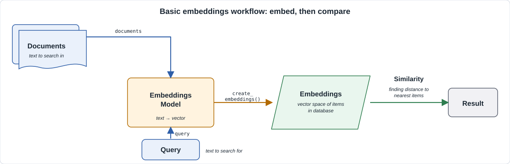
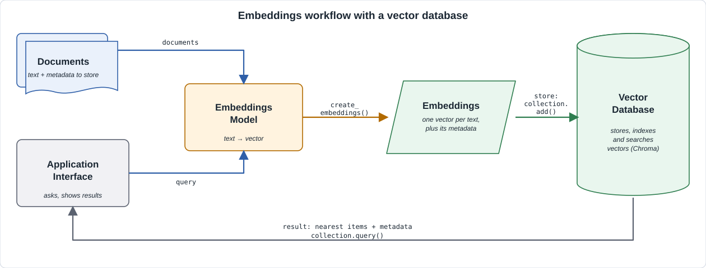

# Working with Chroma (Embedding Database)

## Introduction

An **embedding database**, also called a **vector database**, stores embedding vectors and finds the ones closest to a query vector. **Chroma** is an open-source vector database with a Python client. This guide uses it together with the OpenAI embedding models from [working-with-openai-embeddings.md](working-with-openai-embeddings.md).

It covers:

- Why an embedding database is needed.
- Metadata and how it differs from the vectors and text.
- NoSQL and SQL databases, and why NoSQL fits embeddings.
- Installing Chroma.
- Connecting, creating a collection, adding data, querying, filtering, updating, and deleting.

References:

- Chroma docs: <https://docs.trychroma.com/>
- Chroma source: <https://github.com/chroma-core/chroma>

---

### Why an embedding database is needed

#### Basic embeddings workflow (no database)

This is the workflow from the OpenAI embeddings notes.



1. **Documents** are sent to the **embeddings model**, which returns one vector per text.
2. The **query** goes through the same model and becomes a vector.
3. **Similarity** compares the query vector with every document vector. In the notes this is `find_n_closest()`: it computes the cosine distance to each item and sorts them.
4. The **result** is the closest items.

This works for a handful of texts. It has limits:

| Limit | Effect |
|---|---|
| Vectors live in a Python variable | They are lost when the program ends. You pay to embed the same texts again. |
| Every search compares the query with **all** vectors | Search time grows with the number of items. This is too slow for thousands or millions of items. |
| Vectors, texts, and extra fields are separate lists | You must keep them in sync by index yourself. |
| No filtering | You cannot say "only products under 50 USD" inside the search. |
| No update or delete | To change one item, you rebuild the lists. |

#### Workflow with an embedding database

A vector database fixes these limits. You embed the documents **once**, store them, and then run many queries against the stored data.



What the database adds:

- **Storage**: vectors, original texts, and metadata are saved together and can be persisted to disk.
- **Indexing**: an index (Chroma uses HNSW) finds *approximately* the nearest vectors without comparing against every one. This is called approximate nearest neighbor (ANN) search.
- **Filtering**: combine similarity search with conditions on metadata.
- **Management**: add, update, and delete items without rebuilding everything.
- **Embedding on the fly**: if you give the collection an embedding function, you pass plain text and it creates the vectors for you.

---

### Metadata and non-metadata

Every item in a collection can hold up to four things:

| Part | What it is | Example |
|---|---|---|
| `id` | A unique string that identifies the item. | `"p1"` |
| `document` | The original text. | `"Lightweight laptop with 16 GB RAM"` |
| `embedding` | The vector made from the document. | `[0.012, -0.045, ...]` |
| `metadata` | A dictionary of extra facts about the item. | `{"category": "computers", "price": 899}` |

**Non-metadata** (the vector and the text) describes the *meaning* of an item. It is what similarity search uses.

**Metadata** describes *facts* about an item: category, price, date, author, source. It is not used to compute similarity. It is used to **filter**, and to show extra information next to a result.

| | Without metadata | With metadata |
|---|---|---|
| Search | Nearest items by meaning only. | Nearest items by meaning **and** matching conditions (for example `category == "computers"`). |
| Filtering | Query first, then filter the results in Python. You may lose good matches and get fewer than `n` results. | The database filters during the search. You get `n` results that all match. |
| Showing a result | Only the text. | Text plus price, category, link, and so on. |
| Updating | Change the document to change anything. | Change one field without re-embedding. |

Notes:

- Metadata values must be simple types: string, integer, float, or boolean.
- Metadata is **not** embedded. If a fact should affect similarity, include it in the document text.

---

### NoSQL and SQL databases

| | SQL (relational) | NoSQL |
|---|---|---|
| Data model | Tables with fixed columns and rows. | Flexible: documents, key-value, graph, or vectors. |
| Schema | Defined up front. Changes need a migration. | Flexible or none. Each item can have different fields. |
| Typical query | Exact conditions: `WHERE price < 50`, joins across tables. | Depends on the type: lookup by key, document search, or nearest neighbors. |
| Scaling | Usually vertical (bigger machine). | Usually horizontal (more machines). |
| Examples | PostgreSQL, MySQL, SQLite. | MongoDB, Redis, Neo4j, Chroma. |

**Why NoSQL is used for embedding databases**

- **Different kind of query.** SQL answers "which rows equal this value?" An embedding database answers "which items are *nearest* to this vector?". There is no exact match. It needs a vector index (such as HNSW), not the B-tree index used for exact lookups.
- **Different kind of data.** An embedding is an array of hundreds or thousands of floats (1536 for `text-embedding-3-small`). It does not fit naturally in one relational column, and comparing arrays is not a normal SQL operation.
- **Flexible metadata.** Items in one collection can carry different metadata fields. No table redesign is needed.
- **Easier to scale.** Collections of millions of vectors can be split across machines.

Caveats:

- "NoSQL" describes the data model, not the storage engine. Chroma itself keeps its metadata in a SQLite file when you persist it to disk.
- SQL databases can also do vector search through extensions (for example `pgvector` for PostgreSQL). Chroma is a dedicated vector database and is simpler for small projects.

---

---

## 1. Working with Chroma

**Key concepts**

- **Client**: the object that connects to a Chroma database.
- **Collection**: a named group of items, similar to a table. All items in a collection should be embedded with the **same model**.
- **Item**: an `id`, a `document`, an `embedding`, and optional `metadata`.
- **Embedding function**: code that turns text into vectors. The collection calls it for you when you pass text.

Docs: [Chroma – Getting started](https://docs.trychroma.com/docs/overview/getting-started)

The steps in this section:

1. Install Chroma.
2. Connect to the database.
3. Create a collection.
4. Add data.
5. Update and delete.
6. Query.
7. Filter with metadata.
8. Inspect and retrieve.
9. Persist and manage collections.

### 1.1 Installing Chroma

Requirements: Python 3.9 or newer.

```bash
pip install chromadb
```

Check the install:

```python
import chromadb

print(chromadb.__version__)
```

The OpenAI embedding function used in this guide needs the `openai` package and your API key in the environment:

```bash
pip install openai
```

```bash
# macOS / Linux
export OPENAI_API_KEY="sk-..."

# Windows PowerShell
$env:OPENAI_API_KEY = "sk-..."
```

Notes:

- If `pip` fails while building wheels (for example for `chroma-hnswlib` or `grpcio`), a prebuilt wheel is not available for your Python version. Use a Python version that has wheels, or install the C++ build tools (Windows: Visual Studio Build Tools).
- Without an embedding function, Chroma uses a small default model (`all-MiniLM-L6-v2`) and downloads it on first use. This guide uses OpenAI instead, so that vectors match the other notes.

### 1.2 Connecting to the database

**Key concepts**

- **In-memory client**: data lives in RAM and disappears when the program ends. Good for experiments.
- **Persistent client**: data is saved in a folder on disk and reloaded next time.
- **HTTP client**: connects to a Chroma server running elsewhere.

Docs: [Chroma – Clients](https://docs.trychroma.com/docs/run-chroma/clients)

```python
import chromadb

# In-memory: data is lost when the program ends
client = chromadb.EphemeralClient()

# Persistent: data is saved in the folder "./chroma_db"
client = chromadb.PersistentClient(path="./chroma_db")

# Server: connect to a running Chroma server
client = chromadb.HttpClient(host="localhost", port=8000)
```

Start a local server in a terminal if you use `HttpClient`:

```bash
chroma run --path ./chroma_db
```

Check the connection:

```python
print(client.heartbeat())   # a number if the database responds
```

Tips:

- Use `PersistentClient` for most notes and small projects. The rest of this guide uses it.
- Do not commit the `chroma_db` folder to git.

### 1.3 Creating a collection

**Key concepts**

- `create_collection()` makes a new collection. It fails if the name already exists.
- `get_or_create_collection()` returns the collection if it exists, otherwise creates it. Use it in scripts you run more than once.
- The **embedding function** decides how text becomes vectors.
- The **distance metric** decides how closeness is measured. The default is `l2` (squared Euclidean distance). Use `cosine` to match the notes on OpenAI embeddings.

Docs: [Chroma – Collections](https://docs.trychroma.com/docs/collections/create-get-delete) · [Configure a collection](https://docs.trychroma.com/docs/collections/configure)

```python
import chromadb.utils.embedding_functions as embedding_functions

openai_ef = embedding_functions.OpenAIEmbeddingFunction(
    api_key_env_var="OPENAI_API_KEY",       # name of the environment variable
    model_name="text-embedding-3-small",
)

collection = client.get_or_create_collection(
    name="products",
    embedding_function=openai_ef,
    configuration={"hnsw": {"space": "cosine"}},   # use cosine distance
)
```

| Argument | What it does |
|---|---|
| `name` | The collection name. It must be unique in the database. |
| `embedding_function` | Turns text into vectors, for `add()` and for `query()`. |
| `configuration={"hnsw": {"space": ...}}` | Distance metric: `"l2"` (default), `"ip"` (inner product), or `"cosine"`. |

Notes:

- The distance metric is fixed when the collection is created. Create a new collection to change it.
- Older versions of Chroma set the metric with `metadata={"hnsw:space": "cosine"}`; check the docs for your version.
- Cosine distance is `1 - cosine similarity`: smaller means closer, as in the OpenAI embeddings notes.

### 1.4 Adding data

**Key concepts**

- `collection.add()` stores items.
- It takes parallel lists: `ids`, `documents`, and optionally `metadatas`. Item `i` is described by element `i` of each list.
- With an embedding function, Chroma creates the embeddings for you.
- Ids must be **unique strings**. Adding an id that already exists does not replace it. Use `upsert()` for that (see 1.5).

Docs: [Chroma – Add data](https://docs.trychroma.com/docs/collections/add-data)

```python
products = [
    {"id": "p1", "text": "Lightweight laptop with 16 GB RAM and a long battery life",
     "category": "computers", "price": 899, "in_stock": True},
    {"id": "p2", "text": "Gaming desktop with a fast graphics card",
     "category": "computers", "price": 1499, "in_stock": False},
    {"id": "p3", "text": "Wireless noise-cancelling headphones",
     "category": "audio", "price": 199, "in_stock": True},
    {"id": "p4", "text": "Bluetooth speaker with deep bass",
     "category": "audio", "price": 59, "in_stock": True},
    {"id": "p5", "text": "Non-stick frying pan for everyday cooking",
     "category": "kitchen", "price": 25, "in_stock": True},
]

collection.add(
    ids=[p["id"] for p in products],                  # unique id per item
    documents=[p["text"] for p in products],          # text to embed and store
    metadatas=[                                       # facts, not embedded
        {"category": p["category"], "price": p["price"], "in_stock": p["in_stock"]}
        for p in products
    ],
)
```

What happens:

1. Chroma sends the `documents` to the embedding function (the OpenAI API).
2. It stores each id, document, embedding, and metadata together.

If you already have vectors (for example from `client.embeddings.create()` in the OpenAI notes), pass them in:

```python
collection.add(
    ids=["p6"],
    documents=["Electric kettle with auto shut-off"],
    embeddings=[vector],          # list of floats, same model as the rest of the collection
    metadatas=[{"category": "kitchen", "price": 35, "in_stock": True}],
)
```

Tips:

- `documents` is optional, but without it you cannot show the original text or use `where_document`.
- Add in batches for large data. Do not add one item per call.
- Every vector in a collection must have the same length.

### 1.5 Updating and deleting

**Key concepts**

- `update()` changes existing items. The ids must exist.
- `upsert()` updates an item if the id exists, otherwise adds it.
- `delete()` removes items by id or by filter.
- If you change a document, Chroma creates a new embedding for it.

```python
# Change metadata only (no re-embedding)
collection.update(
    ids=["p2"],
    metadatas=[{"category": "computers", "price": 1399, "in_stock": True}],
)

# Change the text (the embedding is recomputed)
collection.update(
    ids=["p5"],
    documents=["Ceramic non-stick frying pan, 28 cm"],
)

# Update if the id exists, add if it does not
collection.upsert(
    ids=["p7"],
    documents=["Mechanical keyboard with quiet switches"],
    metadatas=[{"category": "computers", "price": 89, "in_stock": True}],
)

# Delete by id (the item added by upsert)
collection.delete(ids=["p7"])

# Delete by filter: removes every matching item
# (commented out so the products from 1.4 stay for the next examples)
# collection.delete(where={"in_stock": False})
```

Notes:

- `delete()` with no `ids` and no `where` is not allowed. This protects you from deleting everything by mistake.

**`add()` vs `upsert()`**

| | `add()` | `upsert()` |
|---|---|---|
| Id is new | Adds the item. | Adds the item. |
| Id already exists | Does **not** replace the item. The existing item is kept and the new data is ignored (Chroma logs a warning). | **Replaces** the stored document, metadata, and embedding with the new data. |
| Use for | First load of data that you know is new. | Loading data that may already be there, or re-running a script. |

```python
collection.add(ids=["p1"], documents=["Old text"])
collection.add(ids=["p1"], documents=["New text"])      # ignored: p1 still has "Old text"

collection.upsert(ids=["p1"], documents=["New text"])   # p1 now has "New text" (re-embedded)
```

### 1.6 Querying

**Key concepts**

- `collection.query()` finds the items nearest to the query.
- `query_texts` is a list of search strings. Chroma embeds them with the collection's embedding function.
- `query_embeddings` is an alternative: pass vectors you already made.
- `n_results` is how many items to return per query.
- This replaces the `create_embeddings()` + `find_n_closest()` code from the notes with one call.

Docs: [Chroma – Query and get](https://docs.trychroma.com/docs/querying-collections/query-and-get)

```python
results = collection.query(
    query_texts=["a computer for work"],   # a list, even for one query
    n_results=3,
)

print(results)
```

The result is a dictionary. **Each value is a list of lists**: one inner list per query text.

```python
{
    "ids":       [["p1", "p2", "p3"]],
    "documents": [["Lightweight laptop ...", "Gaming desktop ...", "Wireless noise-cancelling ..."]],
    "metadatas": [[{"category": "computers", ...}, {...}, {...}]],
    "distances": [[0.31, 0.38, 0.61]],      # illustrative numbers
    "embeddings": None,                     # not returned unless requested
    ...
}
```

Read the result for the first (and only) query with `[0]`:

```python
for id_, doc, meta, dist in zip(
    results["ids"][0],
    results["documents"][0],
    results["metadatas"][0],
    results["distances"][0],
):
    print(f"{dist:.3f} | {id_} | {doc} | {meta['price']} USD")
```

| Key | Meaning |
|---|---|
| `ids` | Ids of the nearest items, closest first. |
| `documents` | The stored texts. |
| `metadatas` | The stored metadata. |
| `distances` | Distance to each item. Smaller is closer. Items are already sorted. |

Choose what comes back with `include`:

```python
results = collection.query(
    query_texts=["a computer for work"],
    n_results=3,
    include=["documents", "distances"],     # also: "metadatas", "embeddings"
)
```

Comparing with the OpenAI notes:

- `find_n_closest()` returned `{"distance", "index"}` and you mapped the index back to the item. Here the result already contains the id, text, and metadata.
- Several queries in one call, such as `query_texts=["laptop", "speaker"]`, return one inner list per query.

### 1.7 Filtering with metadata

**Key concepts**

- `where` filters on **metadata**. `where_document` filters on the **document text**.
- The filter is applied **together with** the similarity search.
- Filters use operators written as dictionary keys.

Docs: [Chroma – Metadata filtering](https://docs.trychroma.com/docs/querying-collections/metadata-filtering)

| Operator | Meaning |
|---|---|
| `$eq`, `$ne` | Equal, not equal. |
| `$gt`, `$gte`, `$lt`, `$lte` | Greater, greater or equal, less, less or equal (numbers). |
| `$in`, `$nin` | Value is in, or not in, a list. |
| `$and`, `$or` | Combine conditions. |
| `$contains` (in `where_document`) | The document text contains a string. |

```python
# One condition (the same as {"category": {"$eq": "audio"}})
results = collection.query(
    query_texts=["something to listen to music"],
    n_results=2,
    where={"category": "audio"},
)

# Several conditions
results = collection.query(
    query_texts=["something to listen to music"],
    n_results=2,
    where={"$and": [
        {"category": "audio"},
        {"price": {"$lt": 100}},
        {"in_stock": True},
    ]},
)

# Filter on the document text
results = collection.query(
    query_texts=["something to listen to music"],
    n_results=2,
    where_document={"$contains": "Bluetooth"},
)
```

Notes:

- Only items that match the filter are considered. You still get up to `n_results` of them.
- A key that does not exist in an item's metadata does not match.
- Use exactly the same value types you stored. `"899"` (string) does not match `899` (integer).

### 1.8 Inspecting and retrieving

**Key concepts**

- `get()` reads items **without** similarity search: by id, by filter, or all items.
- `count()` returns the number of items.
- `peek()` shows the first few items.
- Unlike `query()`, `get()` returns flat lists, not lists of lists.

```python
print(collection.count())            # number of stored items

print(collection.peek(2))            # first 2 items

# Get by id
item = collection.get(ids=["p3"], include=["documents", "metadatas"])
print(item["documents"][0])          # flat list: index 0 is the item

# Get by metadata filter
cheap = collection.get(where={"price": {"$lt": 100}})
print(cheap["ids"])                  # ['p4', 'p5'] for the five products from 1.4

# Include the stored vector
with_vector = collection.get(ids=["p1"], include=["embeddings"])
print(len(with_vector["embeddings"][0]))   # 1536
```

**`get()` vs `query()`**

`query()` answers "which items are *closest in meaning* to this text?". `get()` answers "give me the items that match these ids or conditions". `get()` never compares vectors.

The same filter behaves differently in each call:

```python
# get(): ALL items under 100, in no ranked order, no distances
collection.get(where={"price": {"$lt": 100}})

# query(): the 2 items under 100 that are closest to the text, ranked, with distances
collection.query(
    query_texts=["small audio device"],
    n_results=2,
    where={"price": {"$lt": 100}},
)
```

### 1.9 Persisting and managing collections

**Key concepts**

- With `PersistentClient`, data is saved to disk automatically. Open the same `path` later to read it again.
- Manage collections with the client.

```python
# Later, in a new program
client = chromadb.PersistentClient(path="./chroma_db")

# List the collections (names are in the result)
print(client.list_collections())

# Open an existing collection. Give the same embedding function.
collection = client.get_collection(name="products", embedding_function=openai_ef)
print(collection.count())

# Delete a whole collection
client.delete_collection(name="products")
```

Tips:

- The embedding function is **not saved** with the data. Pass the same function and model again when you open the collection. A different model gives vectors that cannot be compared.
- To start fresh in a script, call `delete_collection()` first or use a new folder.

---

## 2. Chroma compared with Qdrant

Qdrant is another open-source vector database. Both store vectors and find the nearest ones. They differ in how much they do for you and how far they scale.

### 2.1 Terms

| Idea | Chroma | Qdrant |
|---|---|---|
| Group of items | collection | collection |
| One item | item (`id`, `document`, `metadata`, embedding) | point (`id`, vector, `payload`) |
| Facts used to filter | `metadatas` | `payload` |
| Original text | stored as `documents` | not a separate field. Put it in the payload. |
| Id type | string | unsigned integer or UUID |

### 2.2 Same tasks in code

```python
# Chroma: connect, create, add, find similar
import chromadb
client = chromadb.PersistentClient(path="./chroma_db")
collection = client.get_or_create_collection("products", embedding_function=ef)
collection.add(ids=["p1"], documents=["wireless headphones"], metadatas=[{"category": "audio"}])
results = collection.query(query_texts=["music"], n_results=3, where={"category": "audio"})
```

```python
# Qdrant: connect, create, add, find similar
from qdrant_client import QdrantClient, models

client = QdrantClient(path="./qdrant_db")  # or ":memory:" or url="http://localhost:6333"
client.create_collection(
    "products",
    vectors_config=models.VectorParams(size=1536, distance=models.Distance.COSINE),
)
# You compute the vectors yourself (for example with an OpenAI embedding call)
client.upsert("products", points=[
    models.PointStruct(id=1, vector=vec, payload={"text": "wireless headphones", "category": "audio"}),
])
results = client.query_points(
    "products",
    query=query_vec,
    limit=3,
    query_filter=models.Filter(must=[
        models.FieldCondition(key="category", match=models.MatchValue(value="audio")),
    ]),
)
```

### 2.3 Differences

| Topic | Chroma | Qdrant |
|---|---|---|
| Embeddings | Can embed text for you through an embedding function | You pass vectors. Optional FastEmbed add-on can embed locally. |
| Vector size | Set by the embedding function | Must be given when the collection is created |
| Add items | `add()` (rejects existing ids), `upsert()` | `upsert()` (add or overwrite) |
| Query input | Text or vectors | Vectors (or text with FastEmbed) |
| Filter syntax | Dictionaries: `{"category": "audio"}`, `$and`, `$or` | Objects: `Filter`, `FieldCondition`, `MatchValue` (`must`, `should`, `must_not`) |
| Filter speed | Fine for small data | Payload indexes make filtering fast on large data |
| Search types | Dense vectors, plus text filters | Dense, sparse, hybrid, multiple vectors per point |
| Scaling | Best for one machine or small servers | Sharding and replication for large clusters |
| Memory use | Vectors kept in the HNSW index | Adds quantization and on-disk storage to reduce memory |
| Written in | Python / Rust core | Rust |
| Run modes | In-memory, local folder, server, cloud | In-memory, local folder, Docker server, cloud |
| Learning curve | Low. Few concepts. | Higher. More settings and types. |

### 2.4 When to choose which

- **Chroma:** prototypes, notebooks, small apps, learning RAG. Text goes in, similar text comes out, with little setup.
- **Qdrant:** production services, large data (millions of vectors or more), heavy filtering, hybrid search, or when you need clustering and tight memory control.

Tips:

- The core idea is the same in both: embed, store with filterable facts, find the nearest vectors. Moving between them mostly means rewriting the connect, filter and embedding code.
- With Qdrant, keep the embedding model next to the collection. Like Chroma, it does not remember which model made the vectors.

---

## Summary

| Task | How |
|---|---|
| Install | `pip install chromadb` |
| Connect (memory) | `chromadb.EphemeralClient()` |
| Connect (disk) | `chromadb.PersistentClient(path="./chroma_db")` |
| Connect (server) | `chromadb.HttpClient(host="localhost", port=8000)` |
| Embedding function | `embedding_functions.OpenAIEmbeddingFunction(api_key_env_var=..., model_name=...)` |
| Create collection | `client.get_or_create_collection(name, embedding_function=ef, configuration={"hnsw": {"space": "cosine"}})` |
| Add items | `collection.add(ids=..., documents=..., metadatas=...)`, `collection.upsert(...)` (add new, overwrite existing) |
| Find similar items (nearby vectors) | `collection.query(query_texts=[...], n_results=n)` |
| Read query results | `results["documents"][0]` (list of lists: `[0]` is the first query) |
| Filter metadata | `where={"category": "audio"}`, `$and`, `$or`, `$lt`, `$in` |
| Filter text | `where_document={"$contains": "..."}` |
| Get specific items | `collection.get(ids=...)`, `collection.get(where=...)`, `collection.peek()` |
| Count items | `collection.count()` |
| Change items | `collection.update(...)` (existing only), `collection.upsert(...)` |
| Delete items | `collection.delete(ids=...)`, `collection.delete(where=...)` |
| List collections | `client.list_collections()` |
| Open later | `client.get_collection(name, embedding_function=ef)` |
| Delete collection | `client.delete_collection(name)` |
| Metadata | Facts used to filter. Not embedded, not used for similarity. |
