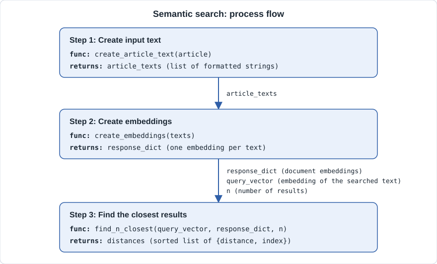
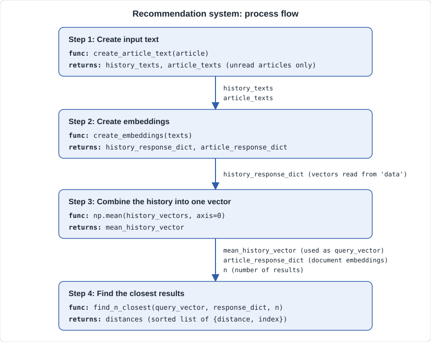
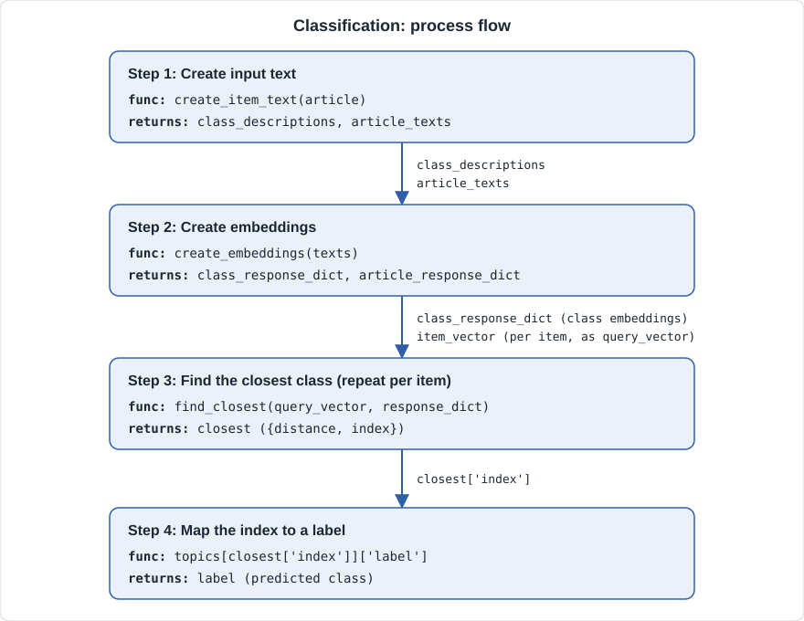
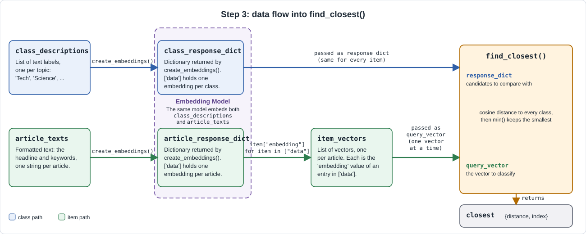

# Working with OpenAI Embeddings

## Introduction

An **embedding vector** is a list of numbers that represents a piece of text. An embedding model converts text into vectors so that words and sentences with similar meaning and context end up close together in vector space.

- "king" and "queen" sit near each other. "king" and "banana" sit far apart.
- Closeness is measured with a distance or similarity score, for example cosine similarity.
- The model captures meaning, not exact spelling. "cheap flights" and "low-cost airfare" get nearby vectors.

Dimensions:

- Diagrams usually show embeddings as points in 2D or 3D, because we can only draw that many axes.
- Real embeddings have many more dimensions. OpenAI's `text-embedding-3-small` returns **1536** numbers per text. `text-embedding-3-large` returns **3072**.

Use cases:

- **Search engines**: match a query to documents by meaning, not only by keywords.
- **Recommendation systems**: suggest items whose vectors are close to items the user liked.
- **Text sentiment**: use embeddings as input features to classify positive or negative text.
- **Categorizing products**: group or label products by the similarity of their descriptions.

This guide uses the OpenAI API. It covers:

- Installation.
- Creating a single embedding.
- Visualizing many embeddings with t-SNE.
- Plotting the result with Matplotlib `plt.scatter()`.
- Semantic search: finding the texts closest in meaning to a query.
- Recommendation systems: suggesting items based on a user's history.
- Classification: assigning labels by comparing items with class embeddings.

Model names change over time, so check the model list.

References:

- Embeddings guide: <https://platform.openai.com/docs/guides/embeddings>
- API reference: <https://platform.openai.com/docs/api-reference/embeddings>

---

## 1. Creating Single Embeddings

**Key concepts**

- `client.embeddings.create()` sends text and returns its embedding.
- `model` selects the embedding model, for example `text-embedding-3-small`.
- `input` is the text to embed. Here it is one string.
- The response holds the vector, the token usage, and metadata.

Docs: [API reference – Create embeddings](https://platform.openai.com/docs/api-reference/embeddings/create)

### 1.1 Installation

Install the packages used in this guide:

```bash
pip install openai scikit-learn matplotlib numpy scipy
```

| Package | Used for |
|---|---|
| `openai` | Calling the OpenAI API |
| `scikit-learn` | t-SNE (`sklearn.manifold.TSNE`) |
| `matplotlib` | Plotting (`plt.scatter`) |
| `numpy` | Converting lists of vectors into arrays |
| `scipy` | Cosine distance (`scipy.spatial.distance.cosine`) for semantic search |

Set your API key as an environment variable. Never hard-code it or commit it to git.

```bash
# macOS / Linux
export OPENAI_API_KEY="sk-..."

# Windows PowerShell
$env:OPENAI_API_KEY = "sk-..."
```

Create the client. It reads `OPENAI_API_KEY` from the environment.

```python
from openai import OpenAI

client = OpenAI()
```

### 1.2 Embed one string

```python
response = client.embeddings.create(
    model="text-embedding-3-small",
    input="Embeddings place similar meanings close together.",
)
```

### 1.3 Return values

The SDK returns a response object. Convert it to a plain dictionary with `model_dump()`.

```python
response_dict = response.model_dump()
print(response_dict)
# {'data': [{'embedding': [0.0123, -0.0456, ...], 'index': 0, 'object': 'embedding'}],
#  'model': 'text-embedding-3-small',
#  'object': 'list',
#  'usage': {'prompt_tokens': 8, 'total_tokens': 8}}
```

| Key | Meaning |
|---|---|
| `data` | A list with one item per input string. |
| `data[i]['embedding']` | The vector: a list of floats (1536 numbers for `text-embedding-3-small`). |
| `data[i]['index']` | Position of the matching input string. |
| `model` | The model that produced the embedding. |
| `usage` | Token counts, used for billing. Contains `prompt_tokens` and `total_tokens`. |

### 1.4 Accessing nested keys

The response is a dictionary with **nested** keys. Chain the keys, one pair of brackets per level.

```python
# Token usage: 'usage' is a dictionary
total_tokens = response_dict['usage']['total_tokens']

# The vector: 'data' is a list, so take item 0 first
embedding = response_dict['data'][0]['embedding']

print(total_tokens)     # 8
print(len(embedding))   # 1536
```

Notes:

- `response_dict['usage']['total_tokens']` is a dictionary inside a dictionary. Use key, then key.
- The vector is **not** under `usage`. It is under `data`, which is a **list**. Use `['data'][0]['embedding']`.
- `['usage'][0]['embedding']` fails, because `usage` is a dictionary with no key `0` and no `embedding`.
- Without converting, use attribute access: `response.usage.total_tokens` and `response.data[0].embedding`.
- To embed several strings in one call, pass a list to `input`. Then `data` has one item per string.

```python
texts = ["I love this phone", "Great battery life", "The soup was cold"]

response = client.embeddings.create(model="text-embedding-3-small", input=texts)
embeddings = [item.embedding for item in response.data]
print(len(embeddings))  # 3
```

---

## 2. Reducing Embedding Dimensions and Plotting

An embedding has too many dimensions to draw. This section has two parts:

- **2.1** reduces the vectors to 2 dimensions with t-SNE.
- **2.2** plots the 2D points with `plt.scatter()`.

### 2.1 Reducing dimensions with t-SNE

**Key concepts**

- A 1536-number vector cannot be drawn directly. To plot it, reduce it to 2 dimensions.
- **t-SNE** (t-distributed Stochastic Neighbor Embedding) is a dimensionality-reduction method. It places similar vectors near each other in 2D, so clusters become visible.
- Input: an array of shape `(n_samples, 1536)`. Output: an array of shape `(n_samples, 2)`.

Docs: [scikit-learn – `TSNE`](https://scikit-learn.org/stable/modules/generated/sklearn.manifold.TSNE.html)

The steps:

1. Prepare the sample input data (the `model_dump()` response).
2. Extract the categories.
3. Extract the embeddings.
4. Convert the embeddings to a NumPy array.
5. Create the t-SNE object with parameters.
6. Run `fit_transform()`.

#### 2.1.1 Sample input data

The input is the dictionary returned by `model_dump()` (see section 1.3), plus a category for each text. Send several texts in one call, so `data` holds one item per text.

```python
# --- Step 1: sample input data ---------------------------------------
# Each product has a text to embed and a category label.
products = [
    {"text": "Wireless noise-cancelling headphones", "category": "electronics"},
    {"text": "Bluetooth speaker with deep bass",     "category": "electronics"},
    {"text": "4K smart TV with HDR",                 "category": "electronics"},
    {"text": "Lightweight running shoes",            "category": "clothing"},
    {"text": "Waterproof hiking jacket",             "category": "clothing"},
    {"text": "Cotton crew-neck t-shirt",             "category": "clothing"},
    {"text": "Non-stick frying pan",                 "category": "kitchen"},
    {"text": "Stainless steel kitchen knife set",    "category": "kitchen"},
    {"text": "Electric kettle with auto shut-off",   "category": "kitchen"},
]

texts = [p["text"] for p in products]

response = client.embeddings.create(model="text-embedding-3-small", input=texts)

# Convert the response object to a plain dictionary
response_dict = response.model_dump()
```

`response_dict` has this shape. The vectors are shortened here; each real vector has 1536 numbers.

```python
{
    "object": "list",
    "model": "text-embedding-3-small",
    "data": [
        {"object": "embedding", "index": 0, "embedding": [0.0123, -0.0456, ...]},  # headphones
        {"object": "embedding", "index": 1, "embedding": [0.0098, -0.0391, ...]},  # speaker
        # ... one item per input text, 9 in total
    ],
    "usage": {"prompt_tokens": 40, "total_tokens": 40},
}
```

#### 2.1.2 Extract the categories

The categories are not in the API response. They come from your own data. Keep them in the same order as `texts`, so category `i` matches embedding `i`.

```python
# --- Step 2: extract the categories ----------------------------------
categories = [p["category"] for p in products]
print(categories)  # ['electronics', 'electronics', 'electronics', 'clothing', ...]
```

#### 2.1.3 Extract the embeddings

Read each vector from `data`, then `embedding`. Use the nested-key access from section 1.4.

```python
# --- Step 3: extract the embeddings ----------------------------------
embeddings = [item["embedding"] for item in response_dict["data"]]

print(len(embeddings))      # 9 vectors
print(len(embeddings[0]))   # 1536 numbers per vector
```

#### 2.1.4 Convert to a NumPy array

t-SNE needs a 2D array, not a list of lists.

```python
# --- Step 4: convert to a NumPy array --------------------------------
import numpy as np

embeddings_array = np.array(embeddings)
print(embeddings_array.shape)  # (9, 1536) = (n_samples, n_dimensions)
```

#### 2.1.5 Create the t-SNE object

```python
# --- Step 5: create t-SNE with parameters ----------------------------
from sklearn.manifold import TSNE

tsne = TSNE(
    n_components=2,     # reduce to 2 dimensions for a flat plot
    perplexity=3,       # must be less than n_samples (9)
    init="pca",         # start from a PCA layout, more stable than random
    learning_rate="auto",
    max_iter=1000,      # number of optimization steps
    random_state=42,    # fixed seed, repeatable result
)
```

| Parameter | What it does |
|---|---|
| `n_components` | Number of output dimensions. Use `2` for a flat plot (`3` for a 3D plot). |
| `perplexity` | Roughly how many neighbors each point considers. Small values focus on local detail. Large values show broader structure. It must be **less than** the number of samples. Typical range is 5 to 50 for larger datasets; use a small value for a small sample. |
| `init` | Starting positions. `"pca"` is more stable than `"random"` and keeps the global layout more consistent. |
| `learning_rate` | Step size of the optimization. `"auto"` picks a sensible value from the sample size. |
| `max_iter` | Number of optimization steps. Older scikit-learn versions call this `n_iter`. |
| `random_state` | Fixes the random seed so the layout is repeatable. Without it, each run gives a different picture. |

#### 2.1.6 Run fit and transform

```python
# --- Step 6: fit and transform ---------------------------------------
embeddings_2d = tsne.fit_transform(embeddings_array)

print(embeddings_2d.shape)  # (9, 2) = (n_samples, 2)
print(embeddings_2d[0])     # x, y position of the first text
```

- `fit_transform()` learns the 2D layout from the data (fit) and returns the new coordinates (transform) in one call.
- t-SNE has **no separate `transform()`** for new data. If you add new texts, run `fit_transform()` again on the full set. The new layout will differ from the old one.
- The output rows keep the same order as the input, so `embeddings_2d[i]` belongs to `texts[i]` and `categories[i]`.

**Risk: information loss** (applies to everything in 2.1 and to the plot in 2.2)

- Squeezing 1536 dimensions into 2 discards information. The plot is a simplified picture, not the real geometry.
- Points that look close in 2D may not be close in the original space, and the reverse can also happen.
- Distances **between** clusters and the size of clusters are not reliable. Only local neighborhoods are meaningful.
- The layout changes with `perplexity` and `random_state`. Try several values before you trust a pattern.
- Use t-SNE to explore and build intuition. Do the real work (search, ranking, classification) on the original vectors.

### 2.2 Plotting with Matplotlib `plt.scatter()`

**Key concepts**

- `plt.scatter(x, y)` draws one point per `(x, y)` pair.
- The two t-SNE columns become the x and y values.
- Label each point with `plt.annotate()` so you can see which text it represents.

Docs: [Matplotlib – `scatter`](https://matplotlib.org/stable/api/_as_gen/matplotlib.pyplot.scatter.html)

```python
import matplotlib.pyplot as plt

plt.scatter(embeddings_2d[:, 0], embeddings_2d[:, 1])

for i, text in enumerate(texts):
    plt.annotate(text, (embeddings_2d[i, 0], embeddings_2d[i, 1]))

plt.title("Text embeddings reduced with t-SNE")
plt.xlabel("t-SNE dimension 1")
plt.ylabel("t-SNE dimension 2")
plt.show()
```

How to read the plot:

- `embeddings_2d[:, 0]` is the x value of every point. `embeddings_2d[:, 1]` is the y value.
- Texts of the same category (for example the three kitchen items) should land closer together than texts of different categories.
- The axes have no units. Only relative position matters.

Tips:

- Color points by category: map each category to a number, then pass it with `c=`, for example `c=[sorted(set(categories)).index(c) for c in categories]`.
- Use more than a handful of texts. With very few points, t-SNE shows little structure.

---

## 3. Semantic Search with Embeddings

**Key concepts**

- **Semantic search** finds texts by meaning, not by matching exact words. A query for "football tournament" can return an article about the World Cup.
- The idea: embed every document once, embed the query, then return the documents whose vectors are closest to the query vector.
- **Cosine distance** measures how far apart two vectors are by the angle between them. It is `1 - cosine similarity`.
  - `0`: same direction (very similar meaning).
  - Larger value: less similar.
  - A **smaller** distance means a **better** match.
- Because vectors keep the order of the input list, the **index** links an embedding back to its original text.

Docs: [SciPy – `distance.cosine`](https://docs.scipy.org/doc/scipy/reference/generated/scipy.spatial.distance.cosine.html)

The steps:

1. Create the input texts.
2. Create the embeddings with a reusable function.
3. Find the closest results.



### 3.1 Create the input text

The input to the embedding model is a list of strings. Each string can be a plain sentence, or a **formatted string** that combines several fields of a record. Putting more context in the text (headline, topic, keywords) gives richer embeddings, because the vector then reflects all of those fields.

```python
# --- Step 1: create the input text -----------------------------------
articles = [
    {"headline": "1.5 Billion Tune-in to the World Cup",
     "topic": "Sport",
     "keywords": ["soccer", "world cup", "tv"]},
    {"headline": "Central Bank Raises Interest Rates Again",
     "topic": "Economy",
     "keywords": ["inflation", "interest rates", "bank"]},
    {"headline": "New Electric Car Doubles Battery Range",
     "topic": "Technology",
     "keywords": ["electric vehicle", "battery", "car"]},
    {"headline": "Marathon Champion Breaks Course Record",
     "topic": "Sport",
     "keywords": ["running", "marathon", "record"]},
    {"headline": "Chip Makers Race to Build Faster AI Hardware",
     "topic": "Technology",
     "keywords": ["ai", "chips", "hardware"]},
]


def create_article_text(article):
    """Format one article dictionary as a single string."""
    return f"""Headline: {article['headline']}
Topic: {article['topic']}
Keywords: {', '.join(article['keywords'])}"""


article_texts = [create_article_text(article) for article in articles]
print(article_texts[0])
# Headline: 1.5 Billion Tune-in to the World Cup
# Topic: Sport
# Keywords: soccer, world cup, tv
```

Notes:

- `article_texts` is a list of formatted strings, one per article.
- Order matters. `article_texts[i]` must stay matched to `articles[i]`.
- `', '.join(...)` turns the keyword list into one readable string.

### 3.2 Create the embeddings

Define a function that sends the list of strings to the API and returns the response as a dictionary. One call embeds every string in the list.

```python
# --- Step 2: create the embeddings -----------------------------------
def create_embeddings(texts):
    """Embed a list of strings. Return the response as a dictionary."""
    response = client.embeddings.create(
        model="text-embedding-3-small",
        input=texts,
    )
    return response.model_dump()


response_dict = create_embeddings(article_texts)

print(len(response_dict["data"]))                    # 5 embeddings, one per article
print(len(response_dict["data"][0]["embedding"]))    # 1536 numbers per embedding
```

- `response_dict["data"]` is a list. Item `i` is the embedding of `article_texts[i]`.
- Each item also has an `index` key that holds `i`.
- To get only the vectors, use `[item["embedding"] for item in response_dict["data"]]`. This is what you did in section 2.1.3.
- Embed the documents **once** and reuse `response_dict`. Only the query is embedded again for each search.

### 3.3 Find the closest results

Define a function that compares the query vector with every document vector and returns the `n` closest ones.

```python
# --- Step 3: find the closest results --------------------------------
from scipy.spatial import distance


def find_n_closest(query_vector, response_dict, n=3):
    """Return the n documents closest to query_vector."""
    distances = []

    # 3a. Compare the query with every document embedding
    for item in response_dict["data"]:
        dist = distance.cosine(query_vector, item["embedding"])
        distances.append({"distance": dist, "index": item["index"]})   # keep the index

    # 3b. Sort: smallest distance first (closest match first)
    distances_sorted = sorted(distances, key=lambda d: d["distance"])

    # 3c. Keep the first n results
    return distances_sorted[:n]
```

How it works:

- **Loop over `response_dict["data"]`**: each `item` holds one document vector (`item["embedding"]`) and its position (`item["index"]`).
- **`distance.cosine(a, b)`**: returns the cosine distance between two vectors. Both vectors must have the same length.
- **Store the index with the distance**: after sorting, the position in the list no longer matches the original order. The saved `index` is how you find the original text.
- **Sort by distance**: `sorted(..., key=lambda d: d["distance"])` sorts ascending. The nearest item comes first.
- **Slice `[:n]`**: keeps the `n` best matches.
- You can also loop with `enumerate()` over a plain list of vectors. Then `index` is the position in that list.

Use it: embed the search text with the same function and model, then take its vector.

```python
# Embed the searched text (a list with one string)
query = "football tournament"
query_response = create_embeddings([query])
query_vector = query_response["data"][0]["embedding"]

# Find the 2 closest articles
closest = find_n_closest(query_vector, response_dict, n=2)

for result in closest:
    print(round(result["distance"], 3), "|", articles[result["index"]]["headline"])
# 0.52 | 1.5 Billion Tune-in to the World Cup
# 0.78 | Marathon Champion Breaks Course Record
```

The distances above are illustrative. Your numbers will differ.

- `result["index"]` gives the position of the article, so `articles[result["index"]]` returns the original record.
- The World Cup article ranks first even though the query contains none of its words. That is the benefit of semantic search.

Tips:

- Use the **same model** for documents and query. Vectors from different models cannot be compared.
- Embed the query as plain text or in the same format as the documents. A format that matches the documents usually works better.
- This loop is fine for small lists. For thousands of documents, use NumPy to compute all distances at once, or a vector database.
- OpenAI embeddings are normalized to length 1, so ranking by cosine distance gives the same order as ranking by dot product or Euclidean distance.

---

## 4. Recommendation Systems with Embeddings

**Key concepts**

- A recommendation system suggests items a user is likely to want. With embeddings, "likely to want" means "close to what the user already read, bought, or liked".
- It reuses the semantic search code from section 3: `create_article_text()`, `create_embeddings()`, and `find_n_closest()`.
- The difference is the **query**. In semantic search, the query is a text the user typed. Here, the query is built from the user's **history**.

**What is added compared to section 3**

| Section 3: semantic search | Section 4: recommendation |
|---|---|
| Query is one searched text | Query comes from the user history: one or more items |
| One query vector | Several history vectors, **combined into one** |
| Every document can be returned | Items already in the history must be **excluded** |
| One embedding step for documents | Two embedding steps: history and candidate items |

The steps:

1. Create the input text for the history and for the candidate items (without the items already seen).
2. Create the embeddings for both lists.
3. Combine the history vectors into one vector with the mean.
4. Find the closest candidates.



### 4.1 Create the input text with the user history

The history is a list of items the user already interacted with. Candidates are all other items.

```python
# --- Step 1: create the input text -----------------------------------
# Sample catalog (redefined here so the history items are part of it)
articles = [
    {"headline": "1.5 Billion Tune-in to the World Cup",
     "topic": "Sport", "keywords": ["soccer", "world cup", "tv"]},
    {"headline": "How NVIDIA GPUs Could Decide Who Wins the AI Race",
     "topic": "Tech", "keywords": ["ai", "business", "computers"]},
    {"headline": "Tech Giant Buys 49% Stake in AI Startup",
     "topic": "Tech", "keywords": ["business", "ai"]},
    {"headline": "Tech Company Launches Innovative Product to Improve Online Accessibility",
     "topic": "Tech", "keywords": ["technology", "accessibility", "web"]},
    {"headline": "Scientists Make Breakthrough Discovery in Renewable Energy",
     "topic": "Science", "keywords": ["energy", "science", "climate"]},
    {"headline": "Central Bank Raises Interest Rates Again",
     "topic": "Economy", "keywords": ["inflation", "interest rates", "bank"]},
]

# Articles the user already read
user_history = [articles[1], articles[2]]

# Candidates: everything the user has NOT read yet
articles_filtered = [a for a in articles if a not in user_history]

history_texts = [create_article_text(a) for a in user_history]
article_texts = [create_article_text(a) for a in articles_filtered]
```

- `create_article_text()` is the function from section 3.1.
- **Filter out the history.** Without this, the closest items to the user's history are the history items themselves (distance near 0).
- Keep `articles_filtered` in the same order as `article_texts`. You need it to map an index back to an article.

### 4.2 Create the embeddings

Call `create_embeddings()` from section 3.2 twice: once for the history, once for the candidates.

```python
# --- Step 2: create the embeddings -----------------------------------
history_response_dict = create_embeddings(history_texts)
article_response_dict = create_embeddings(article_texts)
```

### 4.3 Combine the history into one vector

`find_n_closest()` compares **one** query vector with the documents. The history has several vectors, so merge them into one by taking the **mean**.

```python
# --- Step 3: combine the history vectors ------------------------------
import numpy as np

history_vectors = [item["embedding"] for item in history_response_dict["data"]]

mean_history_vector = np.mean(history_vectors, axis=0)
print(mean_history_vector.shape)  # (1536,) = one vector
```

- `history_vectors` is a list of 2 vectors, each with 1536 numbers.
- `axis=0` averages **down the columns**, so each of the 1536 positions is averaged across the history items. The result is a single vector of 1536 numbers.
- The mean vector sits "between" the history items. It stands for the user's overall interest.
- A history with one item needs no mean. Use that item's vector.

### 4.4 Find the closest results

Reuse `find_n_closest()` from section 3.3. The mean vector is the `query_vector`. The candidate embeddings are the `response_dict`.

```python
# --- Step 4: find the closest results --------------------------------
hits = find_n_closest(mean_history_vector, article_response_dict, n=3)

for hit in hits:
    article = articles_filtered[hit["index"]]     # index refers to articles_filtered, not articles
    print(round(hit["distance"], 3), "|", article["headline"])
```

- Map `hit["index"]` with `articles_filtered`, because the candidate embeddings were built from that list.
- The example result is illustrative: the new tech accessibility article should rank first, because the history is about AI and tech.

Tips:

- The mean treats every history item equally. To favor recent items, use a weighted mean: `np.average(history_vectors, axis=0, weights=[...])`.
- A history with mixed interests (sport and finance) gives a blurred mean that matches neither well. Consider one recommendation per interest.
- A user with no history (cold start) has no query. Fall back to popular or editor-picked items.

---

## 5. Classification with Embeddings

**Key concepts**

- **Classification** assigns a label to an item. Examples: a headline into a topic, a review into positive or negative.
- With embeddings you can classify **without labeled training data**. This is called **zero-shot classification**.
- The idea: embed the labels (classes) too. An item gets the label whose embedding is closest to the item's embedding.
- Embeddings capture meaning, so the item "How NVIDIA GPUs Could Decide Who Wins the AI Race" is close to the label "Tech" even though it never contains that word.

**What is added compared to sections 3 and 4**

| Sections 3 and 4 | Section 5: classification |
|---|---|
| One set of embeddings (documents) | **Two** sets: **class embeddings** and **item embeddings** |
| The query is a search text or a history | The query is each **item to classify** |
| Find the `n` closest documents | Find the **single closest class** (`n = 1`) |
| One search per query | The distance search runs **once per item** |
| The result is a list of documents | The index must be mapped to a **label** |

The steps:

1. Create the input text: class descriptions and the items to classify.
2. Create the embeddings for both.
3. Find the closest class for each item.
4. Map the index to a label.



### 5.1 Create the input text

There are two lists of texts: the class descriptions and the items.

```python
# --- Step 1: create the input text -----------------------------------
# Classes: the labels the model can choose from
topics = [
    {"label": "Tech"},
    {"label": "Science"},
    {"label": "Sport"},
    {"label": "Business"},
]
class_descriptions = [topic["label"] for topic in topics]   # ["Tech", "Science", ...]

# Items to classify: no topic, because the topic is what we want to predict
items = [
    {"headline": "How NVIDIA GPUs Could Decide Who Wins the AI Race",
     "keywords": ["ai", "business", "computers"]},
    {"headline": "1.5 Billion Tune-in to the World Cup",
     "keywords": ["soccer", "world cup", "tv"]},
    {"headline": "Scientists Make Breakthrough Discovery in Renewable Energy",
     "keywords": ["energy", "science", "climate"]},
]


def create_item_text(article):
    """Like create_article_text, but without the topic."""
    return f"""Headline: {article['headline']}
Keywords: {', '.join(article['keywords'])}"""


article_texts = [create_item_text(item) for item in items]
```

- `topics` is a list of dictionaries, so the index of a class in `class_descriptions` matches the index in `topics`.
- Do not include the answer in the item text. Here the `topic` field is dropped.

### 5.2 Create the embeddings

Both lists need embeddings, and both must come from the **same model**.

```python
# --- Step 2: create the embeddings -----------------------------------
class_response_dict = create_embeddings(class_descriptions)   # one vector per class
article_response_dict = create_embeddings(article_texts)       # one vector per item

item_vectors = [item["embedding"] for item in article_response_dict["data"]]
```

- `class_response_dict` is created once and reused for every item.
- `item_vectors` holds one vector per item to classify.

### 5.3 Find the closest class for each item

Classification needs only the **best** match, not a list. This step has two parts:

- **(a)** define the function `find_closest()`.
- **(b)** call it once for each item, with the right data passed in.

The diagram shows how the data objects from steps 1 and 2 are converted and where they end up as inputs of `find_closest()`.



How to read the diagram:

- Rectangles are data objects. Each has a name and a short description.
- Arrows show a conversion (for example `create_embeddings()`) or an object becoming the input of another function.
- Blue is the class path. Green is the item path. Both paths meet at `find_closest()`.

#### a) Define the function `find_closest()`

The function takes two inputs:

| Parameter | Meaning |
|---|---|
| `query_vector` | The **one vector you want to classify**: a single list of numbers (1536 for `text-embedding-3-small`). |
| `response_dict` | The **candidates to compare with**: the dictionary returned by `create_embeddings()`. The function reads each vector from `response_dict["data"][i]["embedding"]`. |

```python
# --- Step 3a: define find_closest ------------------------------------
from scipy.spatial import distance


def find_closest(query_vector, response_dict):
    """Return {distance, index} of the class closest to query_vector."""
    # Create an empty list to collect one result per candidate
    distances = []

    # Loop over every candidate embedding (one per class)
    for item in response_dict["data"]:
        # Calculate the cosine distance between the query vector and the embedding
        dist = distance.cosine(query_vector, item["embedding"])
        # Append the distance and index to distances
        distances.append({"distance": dist, "index": item["index"]})

    # Return the dictionary with the smallest distance (the closest class)
    return min(distances, key=lambda d: d["distance"])
```

- `min()` returns one dictionary, not a list. `find_n_closest(..., n=1)[0]` gives the same result.
- It is `find_n_closest()` from section 3.3 with `n = 1`, written with `min()`.

#### b) Call the function for each item

```python
# --- Step 3b: call find_closest once per item ------------------------
for article, item_vector in zip(items, item_vectors):
    closest = find_closest(item_vector, class_response_dict)
    ...
```

What to pass in:

| Parameter | Value passed | Why |
|---|---|---|
| `response_dict` | `class_response_dict` | The classes are the candidates. The goal is to pick **one class**, so every item is compared with the class embeddings. It is the **whole dictionary**, because the function reads `response_dict["data"]`. It is the same for every item, so it does not change inside the loop. |
| `query_vector` | `item_vector` (one element of `item_vectors`) | Each article is classified on its own, so each article vector takes a turn as the query. `item_vectors` is the list built in 5.2 from `article_response_dict`: each entry is the value under the key `"embedding"` of one item in `["data"]`. The loop takes **one vector** from that list at a time. |

- `zip(items, item_vectors)` pairs each article with its vector, in the same order.
- Each pass returns `closest`, such as `{"distance": 0.31, "index": 0}`. The `index` is the position of the winning class in `class_response_dict["data"]`, which is the position in `topics`.

Common mistakes:

- Passing the whole `item_vectors` list as `query_vector`. The function needs **one** vector, not a list of vectors.
- Passing `article_response_dict` as `response_dict`. That compares the item with other **articles**, not with the **classes**.
- Swapping the two arguments, or embedding the classes and items with different models.

### 5.4 Map the index to a label

`closest["index"]` is the position of the winning class. Use it to read the label from `topics`.

```python
    # --- Step 4: map the index to a label ------------------------------
    label = topics[closest["index"]]["label"]
    print(label, "|", article["headline"])
# Tech     | How NVIDIA GPUs Could Decide Who Wins the AI Race
# Sport    | 1.5 Billion Tune-in to the World Cup
# Science  | Scientists Make Breakthrough Discovery in Renewable Energy
```

The output above is the expected result, not a measured one.

Limitation and improvement:

- Short labels such as "Business" carry little meaning. An item about AI companies can land on "Business" instead of "Tech".
- Make the class descriptions richer, then keep a separate `label` for the output.

```python
topics = [
    {"label": "Tech",     "description": "Tech: technology, computers, software, AI, gadgets"},
    {"label": "Science",  "description": "Science: research, discoveries, space, energy, climate"},
    {"label": "Sport",    "description": "Sport: soccer, tennis, tournaments, athletes, matches"},
    {"label": "Business", "description": "Business: companies, markets, finance, economy, trade"},
]
class_descriptions = [topic["description"] for topic in topics]   # embed the description
# the label printed at the end still comes from topic["label"]
```

- Zero-shot classification needs no training data, but accuracy depends on how well the descriptions separate the classes.
- For sentiment, use descriptions such as "a positive review" and "a negative review".

---

## Summary

| Task | How |
|---|---|
| Install | `pip install openai scikit-learn matplotlib numpy scipy` |
| Create client | `client = OpenAI()` |
| Embed text | `client.embeddings.create(model="text-embedding-3-small", input=text)` |
| Convert response | `response_dict = response.model_dump()` |
| Token usage | `response_dict['usage']['total_tokens']` |
| Get the vector | `response_dict['data'][0]['embedding']` |
| Reduce to 2D | `TSNE(n_components=2, perplexity=...).fit_transform(array)` |
| Plot | `plt.scatter(x, y)` |
| Caveat | t-SNE loses information. Do not trust distances between clusters. |
| Format input | `f"Headline: {...}\nTopic: {...}"` to make one string per record |
| Embed a list | `create_embeddings(texts)` returns `response.model_dump()` |
| Distance | `scipy.spatial.distance.cosine(query_vector, embedding)` (smaller = closer) |
| Nearest `n` | Store `{"distance", "index"}`, `sorted(..., key=...)`, slice `[:n]` |
| Map back | `articles[result["index"]]` |
| Recommend | Exclude history items, `np.mean(history_vectors, axis=0)`, then `find_n_closest()` |
| Classify | Embed classes and items, `find_closest()` per item, `topics[closest["index"]]["label"]` |
